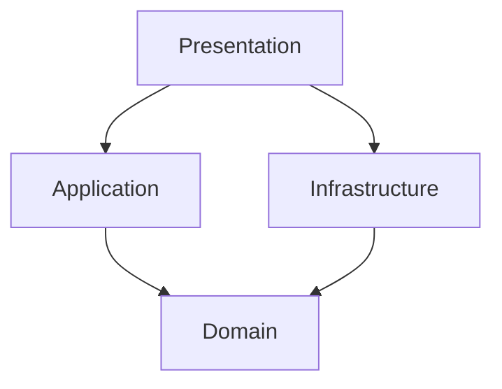

# marketplace-app

## Політика роботи з Git
- main — стабільна версія проєкту.
- develop — гілка для об'єднання змін.
- feature/* — гілки для розробки окремих функцій.

## Архітектура застосунку

Проєкт Marketplace побудований за принципами Clean Architecture та складається з чотирьох шарів:

- **Domain** — містить сутності та інтерфейси репозиторіїв.
- **Application** — містить сценарії роботи з оголошеннями (додавання, видалення, отримання списку).
- **Infrastructure** — містить реалізацію репозиторію для зберігання оголошень у пам'яті.
- **Presentation** — відповідає за підключення залежностей через Dependency Injection.

### Схема архітектури



### Збірка та запуск проєкту

Для запуску проєкту необхідно:

1. Встановити Flutter SDK.
2. Відкрити термінал у папці проєкту.
3. Завантажити залежності:

```bash
flutter pub get
```

4. Запустити перевірку коду:

```bash
flutter analyze
```

5. Запустити застосунок:

```bash
flutter run
```